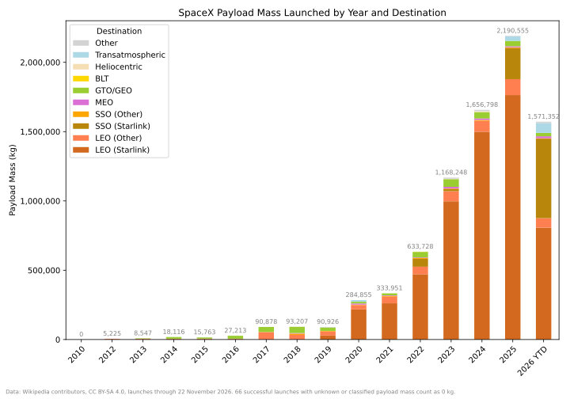
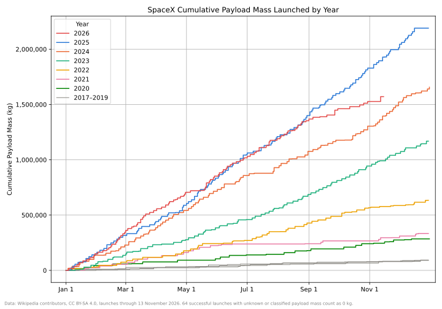

# SpaceX Payload Mass Graphs

This project contains a Python script that fetches data about SpaceX launches from Wikipedia, analyzes the payload mass launched to different destinations over the years, and provides a cumulative sum of the payload mass launched. Suborbital flights, such as Starship test flights carrying Starlink simulators, count as launched mass under the Transatmospheric category.

The scraper reads Wikipedia's year-specific Falcon launch archives as well as the current Falcon and Starship launch pages. The graphs and CSV are derived from those pages, written by Wikipedia contributors and licensed under [CC BY-SA 4.0](https://creativecommons.org/licenses/by-sa/4.0/).

## Payload Mass Launched by Year and Destination



## Cumulative Payload Mass Launched (2017 onwards)



## Running with Docker (recommended)

Docker installs the pinned dependencies for you. You need Docker with Docker Compose.

```bash
docker compose run --rm graphs
```

This fetches the Wikipedia pages and saves the graphs and CSV to `outputs/`. A container has no display, so Docker always saves rather than showing the graphs on screen. To add flags, include `--output` too, as in `docker compose run --rm graphs --output -q`. Downloaded pages are kept in a Docker volume, so later runs only re-download pages that changed.

The container runs as a user with ID 1000. On a Linux host where your user ID differs, run it as your own user so the files it writes in `outputs/` belong to you:

```bash
docker compose run --rm --user "$(id -u):$(id -g)" graphs
```

Keep using the same UID with a given cache volume. Fresh volumes let any UID create files, but the sticky bit prevents non-owners from replacing another UID's files. If you switch UIDs or hit a permission error in an older cache, remove the disposable cache with `docker compose down -v`. This does not remove the bind-mounted `outputs/` directory, which must itself be writable by the UID you run as.

## Running locally

You need Python 3.15 or newer.

```bash
python3 -m venv .venv
source .venv/bin/activate
pip install --require-hashes -r requirements.txt

# Show the graphs on screen
python3 graphs.py

# Save the graphs and CSV to outputs/
python3 graphs.py --output
```

`python3 -m spacex_graphs` supports the same options. Add `-q` to print only warnings and errors.

## Outputs

With `--output`, the script writes three files to `outputs/`:

- `payload_mass_to_orbit_by_year.svg`: a stacked bar chart of payload mass launched to each destination by year
- `cumulative_payload_mass_to_orbit.svg`: a line chart of cumulative payload mass launched, from 2017 onwards
- `spacex_launches.csv`: every parsed launch, with its raw and categorized orbit and its outcome. `Payload Mass (kg)` is the mass Wikipedia reports, blank when unknown or classified. `Counted Mass (kg)` is what the graphs sum, which is 0 for failed launches and for launches whose mass is unknown.

Downloaded pages are cached in `.cache/`. The script asks Wikipedia for updates without re-downloading unchanged pages. It skips regeneration only if every output file still exists and the launch data, UTC date, and `code_version()` fingerprint of the source code and rendering libraries all match the last successful run.

The run fails with exit code 1, rather than publishing questionable graphs, when:

- a page parses to no launches, or a past year has none;
- a launch in the published CSV is missing, or its known mass has become unknown, which usually means part of a table stopped parsing;
- the newest launch found is more than 30 days old, which usually means new launches have stopped parsing;
- Wikipedia can't be reached and the cached pages are more than three days old, or there are no cached pages.

A GitHub Actions workflow runs the script daily and commits any changed outputs, which keeps the graphs above current.

### Troubleshooting scheduled updates

Open the failed run linked in the `scheduled-graph-update` issue and read its annotations and job summary. Close the issue once a scheduled run succeeds.

- If the previous Falcon launch year is missing around New Year, check whether Wikipedia moved it to its own archive. Add the new page and its table layout to `WIKIPEDIA_PAGES` in `config.py`.
- If a published launch or its mass goes missing, check Wikipedia and the parser first. If Wikipedia really removed a launch or mass or corrected a launch date, explain the correction in a PR and delete `outputs/spacex_launches.csv` in that PR. The next scheduled run will establish a fresh validation baseline.

## Project Structure

`graphs.py` and `python3 -m spacex_graphs` are equivalent entry points. The implementation lives in the `spacex_graphs/` package:

- `config.py` — Wikipedia URLs, HTTP settings, orbit-category mapping
- `errors.py` — shared error type for data that cannot be published
- `cache.py` — HTTP caching (ETag/Last-Modified) and change detection
- `parsing.py` — parses launch records from Wikipedia's HTML tables
- `validation.py` — checks the parsed launches are complete enough to publish
- `transform.py` — orbit categorization and DataFrame preparation
- `plotting.py` — builds the matplotlib figures
- `output.py` — writes the SVG and CSV files
- `cli.py` — command-line interface and orchestration

## Development

Install the development tools, which include the runtime dependencies:

```bash
pip install --require-hashes -r requirements-dev.txt
```

CI runs these checks on every pull request and weekly to catch newly disclosed dependency vulnerabilities:

```bash
ruff check .
ruff format --check .
mypy
coverage erase
coverage run --branch -m unittest discover -s tests -v
coverage report --fail-under=95 --show-missing
pip-audit --disable-pip --require-hashes -r requirements.txt
pip-audit --disable-pip --require-hashes -r requirements-dev.txt
scripts/update-locks.sh
git diff --exit-code -- requirements.txt requirements-dev.txt
docker build --tag spacex-graphs .
docker run --rm spacex-graphs --help
docker run --rm --user 12345:12345 --read-only --tmpfs /tmp \
  --cap-drop ALL --security-opt no-new-privileges:true spacex-graphs --help
docker run --rm --user 12345:12345 --read-only --tmpfs /tmp \
  --cap-drop ALL --security-opt no-new-privileges:true \
  --entrypoint python3 spacex-graphs -m spacex_graphs --help
```

Dependencies are declared in `requirements.in` and `requirements-dev.in` and locked, with hashes, in the matching `.txt` files. Edit the `.in` file and run `scripts/update-locks.sh` to change a dependency. For bulk upgrades, match Dependabot's seven-day cooldown by setting a UTC cutoff:

```bash
cutoff=$(python3 -c 'from datetime import UTC, datetime, timedelta; print((datetime.now(UTC) - timedelta(days=7)).isoformat(timespec="seconds"))')
UV_EXCLUDE_NEWER="$cutoff" scripts/update-locks.sh --upgrade
```

Set the environment variable rather than passing `--exclude-newer`, which would change the lock header. CI fails if a lock doesn't match its `.in` file.

Leave regenerating `outputs/` to the scheduled workflow: SVGs rendered on other platforms differ slightly from CI's even for the same data.

## License

The code is released under the [MIT License](LICENSE). The graphs and CSV in `outputs/` are adapted from Wikipedia content by Wikipedia contributors, so they are licensed under [CC BY-SA 4.0](https://creativecommons.org/licenses/by-sa/4.0/) instead; [outputs/README.md](outputs/README.md) has the attribution. The test fixtures are Wikipedia excerpts under the same license, as [tests/fixtures/README.md](tests/fixtures/README.md) notes.

## Contributing

Contributions are welcome. [AGENTS.md](AGENTS.md) describes the project's design rules and conventions, for people and coding agents alike: Conventional Commits, rebasing branches rather than merging `main`, and attaching before-and-after renders when a change alters the graphs.
